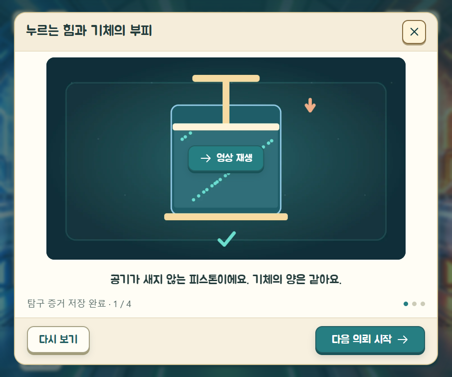
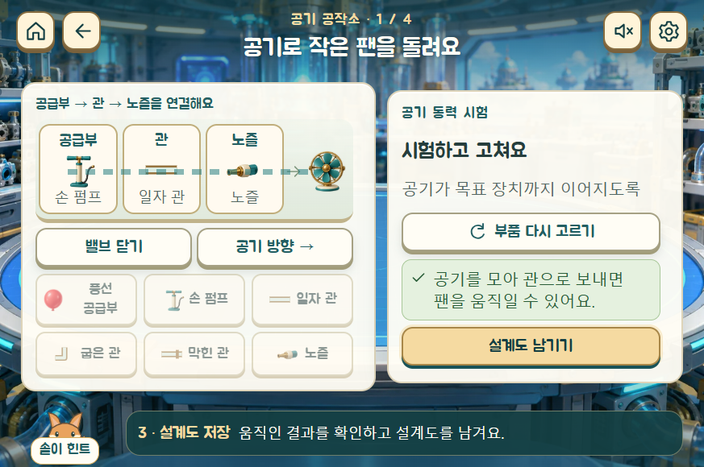
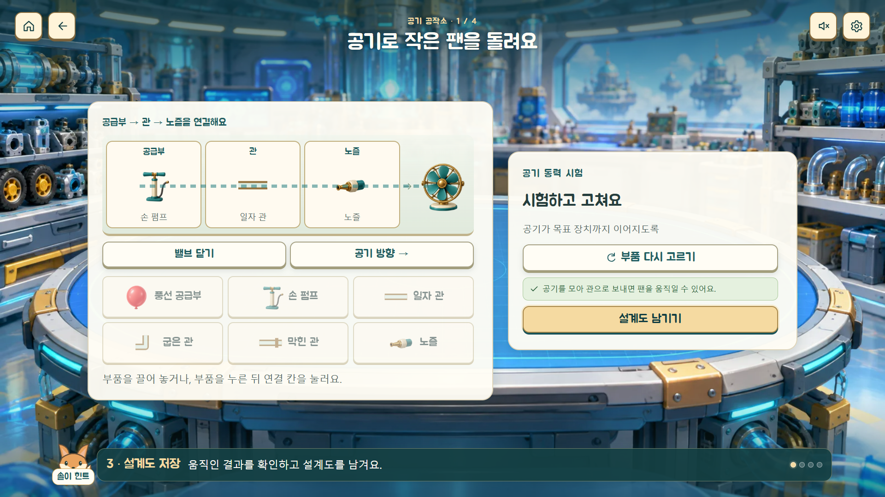

# 학습 UX 개선 및 검수 기록

2026-10-22 · 기체 도시 대작전 v1.1.0

## 적용한 내용

- 20개 의뢰에서 발견을 저장하면 관련된 **9초 개념 영상**을 연다. 기체 흐름·무게·온도·압력·질소·산소·탄산음료·소화기·공기 장치·풍선 자동차의 10종이다. WebM·MP4·마지막 장면 포스터를 제공한다. 30개 파일 합계 약 2.60MB(십진 기준).
- 영상은 한국어 DOM 자막 3개를 0·3·6초에 표시한다. 개념은 실제 실험을 해결한 뒤에만 공개된다. 자동 진행 없이 다음 버튼으로 이동한다. 닫아도 다시 보기와 다음 의뢰 버튼이 남는다. 학습 증거는 영상 재생 전에 저장한다.
- 학생 캐릭터를 따라 걷는 **바람여우 솔이**를 추가했다. 활동 화면에는 힌트 버튼과 현재 단계·다음 행동 안내를 배치했다. 힌트는 한 번에 한 문장씩, 세 단계로 제공한다.
- 관의 연결 경로를 따라 바람이 흐르는 연출, 용기를 저울로 끌어 올리기, 펌프 버튼을 길게 눌러 공기 넣고 빼기, 피스톤 직접 밀기, 기체 카드 배송, 부품 드래그 조립을 연결했다. 클릭하여 고른 뒤 놓기와 키보드 대체 조작도 유지한다.
- 내용만큼 높이가 잡히는 패널, 중앙 모달, 20px 이상의 주요 버튼 글자, 18px 이상의 보조 안내, 짧은 가로 화면 전용 배치를 적용했다. 반복 제목·목표 설명과 불필요한 공백을 줄였다. 공작소 밸브·방향 문구를 축약하고, 성공한 뒤에는 시험 버튼을 숨겨 저장 동작을 강조한다.
- Kenney Interface Sounds(CC0)의 효과음 7개를 자체 호스팅한다. 배경음·효과음 스위치, 단일 효과음 재생, 숨긴 탭에서 소리 정지, 영상 중 BGM 정지를 적용한다. 원본 파일·변환 대응표와 라이선스를 동봉했다.
- 로컬 서버와 오프라인 서비스워커에 영상의 바이트 범위 요청을 처리하도록 보강했다. 영상 탐색·다시 보기와 캐시 재생을 함께 지원한다. 배포 캐시 버전은 1.1.0이다.

## 주요 변경 파일

| 범위 | 파일 |
|---|---|
| 발견 → 개념 영상 → 다음 의뢰 | `src/main.js`, `src/concepts.js` |
| 솔이·힌트·지도 추적 | `src/ui.js`, `src/map.js`, `public/assets/soli.svg` |
| 레이아웃·타이포·간격 | `src/learning-ux.css`, `index.html` |
| 다섯 시설의 실험·조립·배송 | `src/activities/*.js`, `src/touch.js` |
| 음향·출처 | `src/audio.js`, `src/settingsContent.js`, `assets/CREDITS.md`, `public/assets/audio/` |
| 영상·재생 서버·오프라인 | `scripts/render-concepts.mjs`, `scripts/serve.mjs`, `scripts/build.mjs`, `public/assets/concepts/` |
| 반복 검증 | `scripts/qa-learning.mjs`, `scripts/qa-layout.mjs`, `scripts/verify-media.mjs` |

기존 학습 기록 키와 저장 형식은 유지했다. 관리자 해금이 학생의 학습 완료 증거를 자동으로 채우지 않는다.

## 확인 결과

| 검증 | 결과 |
|---|---|
| 기존 모델·저장·길 찾기 테스트 | 20개 통과 |
| 일반 학생 진행 | 20개 의뢰를 실제 UI로 해결, 각 개념 영상 확인, 코어 복구·엔딩·인증서까지 통과 |
| 기본 화면 | 6개 해상도에서 174개 화면/설정 상태. 검사 대상 활동·소개·피날레의 패널 넘침, 작은 조작 글자, 화면 밖 조작 버튼 0건 |
| 추가 상태 | 4개 해상도에서 48개 상태. 터치 드래그 조립·배송, 피스톤 제스처, 비교 질문·성공 화면, 힌트, 영상 닫기·재열기·다음 의뢰 확인 |
| 나머지 페이지·팝업 | 6개 해상도에서 이야기 3장·엔딩 3장·NPC 도움말·연구 가방·초기화 확인 등 54개 상태. 바깥 영역 잘림·넘침 0건 |
| 영상 | 10종 모두 브라우저에서 1280×720·9초 확인, 중간 시점으로 탐색하여 두 번째 자막 확인. 일반 재생 종료와 마지막 장면·재시작·다음 버튼 확인 |
| 파일 무결성 | 30개 파일 크기·SHA-256 일치, MP4·WebM 20개 모두 FFmpeg 전체 디코딩 통과 |
| 재생 예외 | reduced-motion에서 정지 상태 시작, 재생 차단 시 재생 버튼 유지, 파일 실패 시 포스터와 세 자막 표시 |
| 오프라인 | 배포 폴더의 97개 파일을 준비한 뒤 네트워크 차단. 새로고침·활동·영상·4.2초 탐색·효과음 파일 조회 성공. 캐시 MP4의 100바이트 범위 요청이 206/100바이트로 응답 |
| 실행 오류 | 검사 중 앱의 pageerror 0건 |

해상도: 906×755, 1280×800, 1920×1080, 1024×768, 1440×900, 873×580. 짧은 가로 화면에서는 조건 비교 막대를 작은 나란한 도해로 재배치해 글자를 줄이지 않고 질문과 선택지를 함께 보이게 했다.

설정의 교사용 가이드 등 펼친 상세 정보와 긴 연구 기록은 내부 스크롤을 유지한다. 스크롤이 학습 화면 전체나 하단 진행 버튼을 밀지 않는다.

## 확인 범위와 남은 점

Chrome의 별도 테스트 저장소에서 검증했다. 실제 iPad Safari·Android 태블릿·학교 전자칠판 하드웨어에서의 터치 감도와 교실 뒤편 가독성 확인은 남아 있다. 터치 드래그·피스톤은 CDP의 실제 touch 이벤트로 검사했고, 이어지는 버튼은 클릭·키보드 대체 조작으로도 확인했다. 외부 배포는 하지 않았고 로컬 `dist/`를 갱신했다.

## 화면 기록

